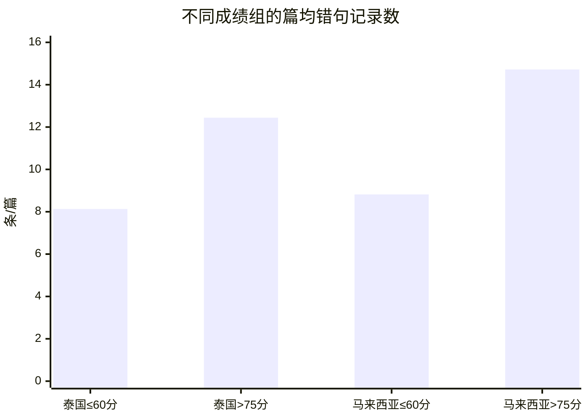
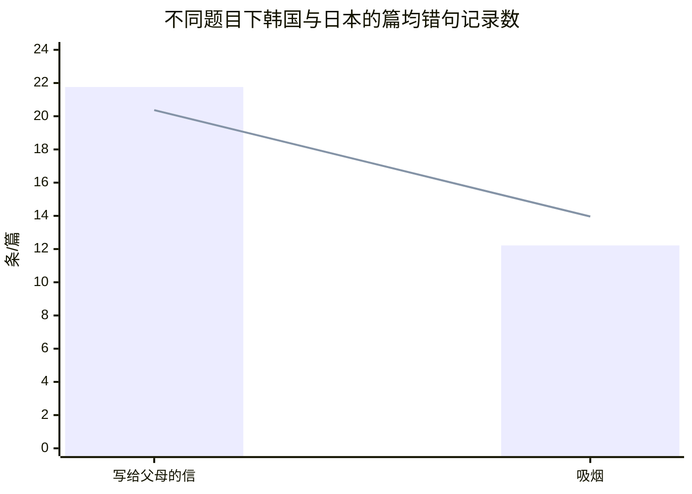

# 一、数据特点与主要问题

## 1. 数据完整但国别样本明显不均衡

现有数据规模较大，包含国籍、考试时间、题目、成绩、证书及错句文本等字段；
元数据较完整，篇内一致性较高，重复记录影响较小，适合开展描述统计和分层比较。
韩国、日本合计占有效作文的65.12%，前八国占89.84%，总体结果容易受到大样本国家主导，小样本国家的均值也更易波动。
## 2. 国家之间的年份与水平构成不同，不能直接比较总体均值

| 比较维度 | 已有统计结果                                 | 对分析的影响               |
| ---- | -------------------------------------- | -------------------- |
| 考试年份 | 美国50%的作文集中于2005年；英国51.85%集中于1994—1996年 | 国别差异可能混入年份、题目及考试背景差异 |
| 作文成绩 | 马来西亚均分80.70，韩国65.91                    | 总体比较并非在相近写作水平下进行     |
| 证书构成 | A、B证书合计占比：马来西亚65.64%，韩国7.82%           | 国家之间的学习者水平构成明显不同     |

因此，国别总体差异只能作为线索，后续需要在相近成绩、共同年份与共同题目范围内检验。

## 3. 错句记录数不能直接解释为偏误率

篇均错句记录数＝错句记录数÷独立作文数，反映的是当前检索数据中的篇均记录数量。一条记录可能包含多个偏误，记录数不等于偏误总数；数据又缺少完整作文长度、总句数及正确表达等分母，且无法确认覆盖零错句作文，因此不能将该指标直接当作真实偏误率。

此外，数据缺少学习者唯一标识、母语、学习时长和教育背景，国籍不能直接替代母语；1992—2005年的历史样本也不能直接代表当前各国汉语教育状况。

## 二、目前已经发现的潜在现象

### 1. 高分组不一定拥有更少的错句记录

泰国和马来西亚的高分组，篇均错句记录数反而更高，说明记录数量与成绩并非简单负相关，可能同时受到篇长、表达复杂度、题目和标注方式影响。

| 国家   | ≤60分 |  >75分 |
| ---- | ---: | ----: |
| 泰国   | 8.13 | 12.44 |
| 马来西亚 | 8.82 | 14.72 |

不同水平作文的偏误类型及构成如何变化？高分作文是否呈现出不同于低分作文的偏误结构？

## 2. 年份与题目会明显影响比较结果

韩国2001年的篇均错句记录数为21.72，2003年为12.23；题目分层同样会改变韩国、日本的比较方向。

图中柱形代表韩国，折线代表日本；折线连接两个题目的数值。

| 题目 | 韩国 | 日本 | 比较方向 |
| --- | ---: | ---: | --- |
| 写给父母的信 | 21.76 | 20.37 | 韩国较高 |
| 吸烟 | 12.22 | 13.96 | 日本较高 |

国别差异是否依赖特定题目或年份？某些题目是否更容易呈现特定偏误？

### 3. 偏误结构可以进一步探索

现有统计已经显示，直接按国家汇总错句数量容易受水平、年份与题目影响。后续可在具备共同样本条件的国家之间，进一步比较偏误类型占比、主要偏误组合及结构相似性，判断是否存在稳定的跨国别模式。

核心问题：在控制成绩、年份和题目等因素后，不同国别样本的偏误结构是否仍存在稳定差异？